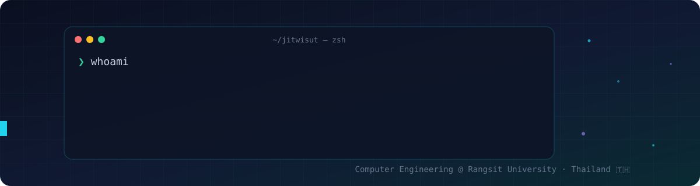
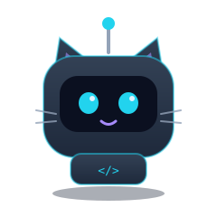

<table>
  <tbody>
    <tr>
      <td width="62%">
        <h1>Hi, I'm Jitwisut! 👋</h1>
        I'm a <b>Computer Engineering</b> student at <b>Rangsit University</b> 🇹🇭 
        I love building <b>web apps and back-end systems</b>, and I'm into <b>AI</b> and <b>Cybersecurity</b>.  
        ⚡ Full-stack with Next.js, ElysiaJS / Bun, FastAPI Database PostgreSQL MongoDB Clickhouse  
        🤖 AI agents, face recognition and real-time apps (WebRTC / WebSockets) 
        🧠 Currently learning <b>System Design</b>, <b>Microservices</b> and <b>CI/CD</b> 
        🌐 Portfolio: <a href="http://portfolio-me-orcin-seven.vercel.app/">portfolio-me-orcin-seven.vercel.app</a>
      </td>
      <td width="38%" align="center">
        
      </td>
    </tr>
  </tbody>
</table>

 

<h2 align="center">☕ My Tech Stack ☕</h2>

<table align="center" width="100%">
<tr>
<td width="50%">

### Frontend

</td>
<td width="50%">

### Backend

</td>
</tr>
<tr>
<td>

### Languages

</td>
<td>

### Databases

</td>
</tr>
<tr>
<td colspan="2">

### Tools & Others

</td>
</tr>
</table>

 

<h2 align="center">🚀 Things I'm Building 🚀</h2>

<table align="center" width="100%">
<tr>
<td width="50%" valign="top">

**⏱️ [AtoAxis](https://www.atoaxis.com)** 
Hosted, WakaTime-compatible developer time tracking with AI-assistance attribution. 
Rust · ClickHouse · Next.js · VS Code extension

</td>
<td width="50%" valign="top">

**🛰️ [Sentinel](https://github.com/Jitwisut/AI-Sentinel)** 
OpenTelemetry-native replay and observability platform for AI agents. 
Rust · Python · TypeScript

</td>
</tr>
<tr>
<td valign="top">

**🧩 [lnwjud](https://github.com/Jitwisut/tan_mcp)** 
Local AI-agent runtime and MCP gateway for Windows and macOS. 
TypeScript · C# · Swift

</td>
<td valign="top">

**🎙️ [JARVIS](https://github.com/Jitwisut/Jarvis)** 
Thai-speaking desktop AI assistant that opens apps, searches the web and plays music. 
Python · FastAPI · Gemini

</td>
</tr>
<tr>
<td valign="top">

**📝 [AI Meeting Minutes](https://github.com/Jitwisut/AI-meeting)** 
Thai meeting transcription → AI summary → human review → publish to SharePoint. 
Python · TypeScript · Docker

</td>
<td valign="top">

**🛡️ [AegisFace](https://github.com/Jitwisut/web-deepface)** 
Multi-angle face recognition with 15-point registration. 
Python · DeepFace

</td>
</tr>
<tr>
<td valign="top">

**💬 [Tinza](https://github.com/Jitwisut/Backend-tinza)** 
Random video-chat matchmaking with WebRTC signaling, interests and safety tools. 
Bun · ElysiaJS · WebRTC

</td>
<td valign="top">

**🤖 [robot-cat](https://github.com/Jitwisut/robot-cat)** 
ESP32 mini battlebot: CAD, Fusion 360 scripts and physics simulation. 
C++ · Python · MuJoCo

</td>
</tr>
</table>

 

<h2>💻 Coding Stats</h2>

<!--START_SECTION:waka-->
<!--END_SECTION:waka-->

 

<h2 id="github_stats" align="center">🔥 GitHub Stats 🔥</h2>

<table>
<tr>
<td align="center">

</td>
<td align="center">

</td>
</tr>
</table>

 

## 🤝 Contact Me

